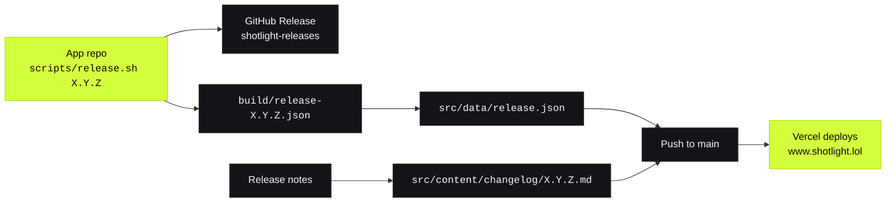

<div align="center">



<br>

[](https://www.shotlight.lol)
[](https://astro.build)
[](https://vercel.com)
[](https://github.com/AMAN123956/shotlight-releases/releases/latest)

**[Visit the site](https://www.shotlight.lol)** · **[Downloads](https://github.com/AMAN123956/shotlight-releases)** · **[Changelog](https://www.shotlight.lol/changelog)**

</div>

---

The public site for [Shotlight](https://github.com/AMAN123956/shotlight-releases), the Mac app that names every
screenshot and finds it by the words inside. A static [Astro](https://astro.build) site, deployed on Vercel.

## Quick start

```bash
npm install
npm run dev       # http://localhost:4321
npm run build     # → dist/
npm run preview
```

## What the site shows



The site uses the "Paper and beam" design: a warm paper ground, ink text and one lime accent, with mockups of the
(dark) app. The home page is static, so it stays fast and needs no scripts to read.

| Page | What's on it |
|---|---|
| `/` | Landing: hero, feature cards, privacy comparison, how it works, download card, FAQ |
| `/download` | The .dmg download, the first-open steps, SHA-256, and the Buy me a coffee button |
| `/guides`, `/guides/<slug>` | How-to guides from `src/content/guides/`. Hidden until a guide is published (see below) |
| `/compare`, `/compare/<slug>` | "Shotlight vs X" pages from `src/content/compare/`. Hidden until published |
| `/changelog` | One entry per release, from `src/content/changelog/` |
| `/privacy` | What the app collects (nothing) and what the site measures (Clarity) |
| `/support` | Bug reports and contact |

## Rules

> [!IMPORTANT]
> **One third party: Microsoft Clarity** (visit analytics, disclosed on `/privacy`). No other external scripts,
> fonts or embeds. Fonts are self-hosted (`@fontsource/geist-sans`, `@fontsource/geist-mono`). `vercel.json` sets a
> Content-Security-Policy that allows same-origin resources plus Clarity's domains, and `astro.config.mjs` stops Vite
> from inlining scripts so the CSP holds.

> [!WARNING]
> **Don't advertise what isn't built.** Check `docs/PRODUCT.md` in the app repo before adding a feature to the copy.

- **One tap downloads.** Every Download button is the `DownloadButton` component: a real link to the `.dmg`
  (`src/lib/links.ts`). `src/lib/download.ts` then moves the person to the first-open steps: on `/download` it scrolls
  to them, anywhere else it opens `/download#first-open` after 1.6 s (long enough for the download to start). When
  `signed` is `true` in `src/data/release.json`, the steps, the scroll and the redirect all switch off.
- **Buy me a coffee stays in the footer, the header and `/download`** (`BUY_ME_A_COFFEE` in `src/lib/links.ts`).
- **Drafts.** A guide with `draft: true` shows in `npm run dev` only. It is left out of the build, the navigation and
  the sitemap until it is verified on a real Mac. Compare pages stay drafts until every cell has a source and a date.
- **Design source:** the website redesign canvas (Design system board). Tokens are in `src/styles/global.css`.

<details>
<summary><b>Analytics events</b></summary>

<br>

Analytics live in `src/lib/analytics.ts`. Clarity (project ID in that file) loads only on `www.shotlight.lol` /
`shotlight.lol`, never on localhost or Vercel preview deployments.

| To record | Do this |
|---|---|
| A click | Give the element `data-track="name"` |
| A Download button | Use `<DownloadButton where="...">`: it records `download_dmg` and tags `download_from` |
| A landing section | `data-section="name"` gives `view_<name>` events (and `demo_<name>` for buttons inside it) |
| Nav, footer, chapters, outbound links, FAQ answers | Recorded automatically |

The full event list is at the top of `analytics.ts`.

</details>

## Map

```
src/
├── pages/                index, download, guides, compare, privacy, verify, support, changelog, 404
├── components/home/      one component per home-page section
├── components/           DownloadButton, GuideCard, Icon, AppIcon, Logo
├── data/release.json     the current version shown on /download (written by the app's scripts/release.sh)
├── data/site.json        the guide byline (leave the name empty to show "Shotlight")
├── content/changelog/    one Markdown file per release
├── content/guides/       one Markdown file per guide (front matter: see src/content.config.ts)
├── content/compare/      one Markdown file per comparison
├── lib/                  analytics, links, download flow, content helpers
└── styles/global.css     tokens and motion
public/                   favicon, apple-touch-icon, og.png, robots.txt
```

## Releasing a new app version



After `scripts/release.sh X.Y.Z` in the app repo has published the GitHub Release:

1. Copy `build/release-X.Y.Z.json` from the app repo to `src/data/release.json`.
2. Add `src/content/changelog/X.Y.Z.md` (front matter: `version`, `date`, `summary`; body: the release notes).
3. Commit and push. Vercel deploys `main`.

> [!NOTE]
> The `/download` button uses GitHub's `releases/latest/download/Shotlight.dmg` link, so it never needs editing.

## Domain

https://www.shotlight.lol (Vercel; `shotlight.lol` redirects to `www`). The old `shotlight-website.vercel.app` and
`shotlight-sand.vercel.app` addresses redirect there (`vercel.json`). The URL is set in `astro.config.mjs` (`SITE_URL`
overrides it) and in the sitemap line of `public/robots.txt`.

<div align="center">
<br>
<sub>Part of <a href="https://www.shotlight.lol">Shotlight</a>: every screenshot, named and findable. Never leaves your Mac.</sub>
</div>
