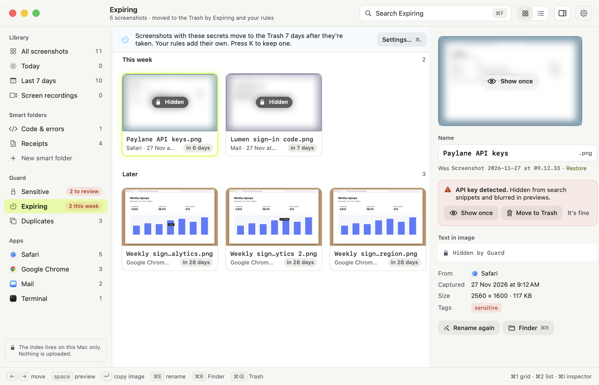

Your Mac saves every screenshot you take and never clears any of them. Most were needed for a minute: a sign-in code, a map, an error you already reported. A year later the Desktop holds hundreds of them. You can clear them out once by hand, or set it up so old ones leave on their own.

| Method | Runs | Best for |
|---|---|---|
| Finder search | When you run it | A one-time cleanup |
| Terminal command | When you run it | The same cleanup every few months, in seconds |
| Shotlight | On its own | Keeping the folder clear without thinking about it |

## Method 1: Find old screenshots in Finder and move them to the Trash

1. Open the folder where your screenshots are saved. On a new Mac that is the **Desktop**.
2. Press <kbd class="key">⌘</kbd> <kbd class="key">F</kbd>. Next to **Search**, click the folder's name so Finder looks only in this folder.
3. Change the first condition from **Kind** to **Name**, choose **contains**, and type `Screenshot`.
4. Click **+** to add a second condition. Choose **Created date**, then **is before**, and enter a date, such as a month ago.
5. Look through the list. Press <kbd class="key">Space</kbd> on any file to preview it, and <kbd class="key">⌘</kbd>-click the ones you want to keep so they are no longer selected.
6. Select the rest and press <kbd class="key">⌘</kbd> <kbd class="key">Delete</kbd> to move them to the Trash.

To run the same search next month, click **Save** before you close the window. Finder keeps it as a Smart Folder in the sidebar. A Smart Folder only lists files. It never deletes anything by itself.

This search goes by name, so it misses screenshots you renamed. The next method does not have that problem.

## Method 2: One Terminal command

When macOS saves a screenshot, it marks the file as a screen capture, and the mark stays when you rename it. Spotlight can search for that mark. Open Terminal and run this to list every screenshot on the Desktop older than 30 days:

```
mdfind -onlyin ~/Desktop 'kMDItemIsScreenCapture == 1 && kMDItemContentCreationDate < $time.today(-30)'
```

Change `~/Desktop` to your screenshot folder and `30` to the number of days you want. The command also looks inside folders within that folder. When the list looks right, run the same search again and send the results to the Trash:

```
mdfind -0 -onlyin ~/Desktop 'kMDItemIsScreenCapture == 1 && kMDItemContentCreationDate < $time.today(-30)' | xargs -0 trash
```

`trash` is a command that comes with macOS 26. It moves files to the Trash the way Finder does, so you can put them back. Many cleanup scripts online use `rm` instead, which deletes files with no way back.

If the first command lists nothing, check that Spotlight is allowed to search that folder in **System Settings**, then **Spotlight**.

## Method 3: Let old screenshots leave on their own, with Shotlight

[Shotlight](/what-is-shotlight) names your screenshots and finds them by the words inside. It can also move them to the Trash after a number of days, in two ways.

A rule. In **Settings**, then **Rules**, you write a rule as a sentence, such as "When app is Messages, move to the Trash after 14 days". The condition can be the app, words in the screenshot, a tag, or whether it is a recording. Under each rule you see how many screenshots it matches today.

Guard › Expiring. A screenshot of a sign-in code is useless after a few minutes and risky to keep. Turn on **Expiring** in the Library under **Guard**, and Shotlight moves screenshots with one-time codes to the Trash after 1, 7 or 30 days. You can add passwords, card numbers and API keys to the list.

Both work the same way once they are on:

1. Nothing moves on the day you set it up. The days count from when you took the screenshot or from when you made the rule, whichever is later.
2. **Library**, then **Expiring**, lists what is due this week and later, with a countdown on each one. Press <kbd class="key">K</kbd> to keep a screenshot.
3. Shotlight only ever moves files to the Trash. **Recently expired** lists them for 30 days with a **Restore** button.



Shotlight shows no notifications about any of this. A line in the menu bar popover says what happened, such as "This week · 6 trashed". It is free while in early access, and the [download page](/download) has the install steps.

## Which screenshots are safe to let go

Most people can let these expire after a week or two:

- Sign-in codes and confirmation screens
- Maps, directions and delivery tracking
- Screenshots you took to send to someone, which already live in the chat
- Retakes of the same screen (the guide to [duplicate screenshots](/guides/find-duplicate-screenshots-mac) covers those)

Keep receipts, invoices, anything to do with taxes or a warranty, and screenshots of settings you might need to set up again. A rule can move those to a folder instead, so they never mix with the ones that expire.

## What this does not cover

These methods move screenshots to the Trash and leave emptying it to you. If you want the Trash to empty itself, open Finder, choose **Settings**, then **Advanced**, and turn on **Remove items from the Trash after 30 days**. If your Desktop is in iCloud Drive, a screenshot you trash on one Mac also leaves your other Macs.

Screenshots in your Photos library are separate. To find a screenshot before it goes, see [how to find old screenshots on Mac](/guides/find-old-screenshots-mac).
