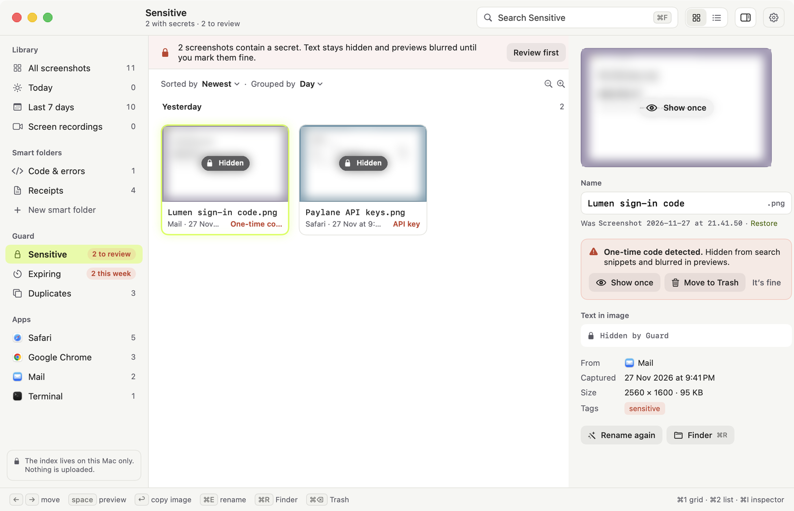

A screenshot shows everything on the screen, and that often includes more than you meant to share: an email address in the corner, a card number in a form, an API key in a terminal, a notification that arrived at the wrong moment. Here is how to cover it with tools already on your Mac, and how to catch the screenshots with secrets that you never meant to keep.

| Method | Safe for text | Best for |
|---|---|---|
| Crop | Yes | Private parts at the edge of the screenshot |
| Solid box in Preview | Yes, once saved as an image | Anything in the middle |
| Redact in Preview (PDF) | Yes | PDFs |
| Blur or pixelate | No | Faces and backgrounds, not text |

## Method 1: Crop it out

If the private part is near an edge, such as the browser tabs or the menu bar, cut it off.

1. Open the screenshot in **Preview**.
2. Drag across the part you want to keep.
3. Press <kbd class="key">⌘</kbd> <kbd class="key">K</kbd> to crop, then <kbd class="key">⌘</kbd> <kbd class="key">S</kbd> to save.

Better still, capture less in the first place. Press <kbd class="key">⇧</kbd> <kbd class="key">⌘</kbd> <kbd class="key">4</kbd>, then <kbd class="key">Space</kbd>, and click a window to capture only that window, without the menu bar, the Dock or your other windows.

## Method 2: Cover it with a solid box in Preview

1. Open the screenshot in **Preview** and click the **Markup** button in the toolbar, or press <kbd class="key">⇧</kbd> <kbd class="key">⌘</kbd> <kbd class="key">A</kbd>.
2. Click **Shapes** and choose the rectangle.
3. Drag the rectangle over the private part.
4. Set **Fill Color** to black or any solid colour, with no transparency.
5. Press <kbd class="key">⌘</kbd> <kbd class="key">S</kbd> to save.
6. Close the file, open it again, and check that the box cannot be selected or moved.

You can do the same right after taking a screenshot. Click the thumbnail that appears in the corner, draw the box in the editor that opens, and click **Done**.

## Method 3: Redact a PDF

Markup shapes on a PDF stay separate from the page, so whoever opens the file can move them and read what is underneath. For a PDF, use the redaction tool instead:

1. Open the PDF in **Preview**.
2. Choose **Tools**, then **Redact**, and select the text or area to remove.
3. Save. Preview removes what you redacted from the file.

Preview's redaction removes what you can see. It does not clean the PDF's hidden details, such as the author name.

## Why blur and pixelation are not enough

Blurred or pixelated text keeps some information about each letter. [Depix](https://github.com/beurtschipper/Depix), published in 2020, recovered pixelated passwords from screenshots. In 2022 the security firm Bishop Fox released [Unredacter](https://bishopfox.com/blog/unredacter-tool-never-pixelation), which decoded a pixelated image that other researchers had posted as a challenge. Small, sharp screen text in a known font is the easiest kind to recover.

A solid box, saved into the image, replaces those pixels completely. Use blur for faces or a messy background, and a solid box for words and numbers.

## What else a screenshot can give away

Before you share a screenshot, look at the edges:

- Browser tabs and bookmarks, which show what else you were reading
- Notifications, which arrive with names and message previews
- Profile pictures, email addresses and account names in the corner of web apps
- File names and folder paths in a terminal or a Finder window
- The file name itself, if you named it after a client or a person

A Mac screenshot does not store your location. The file holds its size, the date it was taken and a note that it is a screenshot.

## Method 4: Catch the screenshots with secrets you forgot, with Shotlight

Covering a secret works when you know it is there. Screenshots taken for yourself never get that check: a code from a sign-in screen, a key in a terminal, a card number you copied from a form. They sit in the folder for months.

[Shotlight](/what-is-shotlight) reads each screenshot on your Mac, and its Guard looks for passwords, API keys, private keys, card numbers and one-time codes. When it finds one:

1. The screenshot is listed under **Guard**, then **Sensitive**, in the Library, and its preview is blurred until you choose **Show once**.
2. Its text is kept out of search, and the screenshot is never added to macOS Spotlight.
3. The secret never goes into the file name or to the language model that writes names.
4. You can move it to the Trash, or mark it as fine.

With **Expiring** turned on, screenshots with one-time codes move to the Trash after 1, 7 or 30 days, and you can add passwords, cards and keys. Shotlight does not change the image itself, so before you share a screenshot it flagged, cover the secret with Method 2. Shotlight is free while in early access, and the [download page](/download) has the install steps.

## What this does not cover

These methods protect screenshots you share as images. A screenshot you paste into a chat or a document has already left your Mac, and covering the original does not change the copy. If you need the words from a screenshot without the image, you can [copy text from a screenshot](/guides/copy-text-from-screenshot-mac) and share only the part you need.
