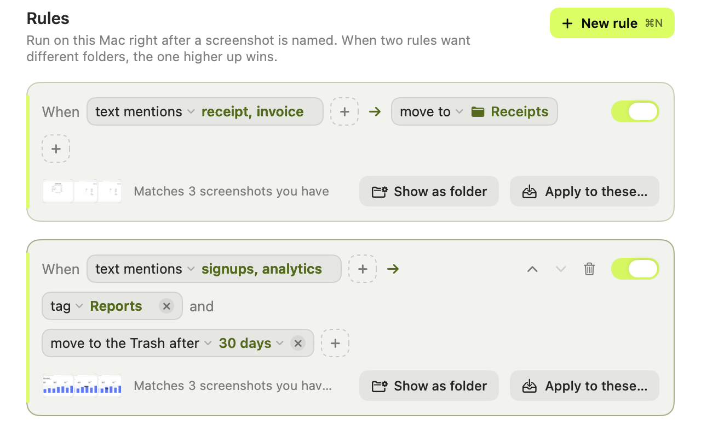

Mac screenshots pile up on the Desktop with names like `Screenshot 2026-11-12 at 9.41.07 PM.png`, and after a few months there are hundreds. Fixing that takes one folder, names that tell the screenshots apart, and a habit of clearing out the ones you are done with. Here is how to set that up with only macOS, and then how Shotlight does it as you capture.

| Step | With only macOS | With Shotlight |
|---|---|---|
| One place for them | Save to a folder in Pictures | Setup offers to move them there |
| Names that say what they show | Rename by hand | Named as you take them |
| Pull out the ones you need | Smart Folders and tags | Rules, smart folders and search |
| Clear out the rest | Finder search, by hand | Duplicates and expiry, with Undo |

## Give screenshots one folder

The Desktop is where macOS saves screenshots, and it is the worst place to keep them. Make a folder called Screenshots in **Pictures** and point new screenshots at it: press <kbd class="key">⇧</kbd> <kbd class="key">⌘</kbd> <kbd class="key">5</kbd>, click **Options**, and choose it under **Save to**. The guide to [changing where screenshots are saved](/guides/change-screenshot-location-mac) has the details and a Terminal version.

If you would rather keep them on the Desktop, click the Desktop, then choose **View**, then **Use Stacks**. macOS piles every screenshot into one stack, and clicking it fans them out.

## Name the ones you keep

A date and a time say nothing about what is in a screenshot. Rename the ones you will want again so the name says what they show, such as `Router settings page.png` or `Figma onboarding flow.png`. Press <kbd class="key">Return</kbd> on a file in Finder to rename it. [How to rename screenshots on Mac](/guides/rename-screenshots-mac) covers renaming many at once.

## Use Smart Folders for the views you need

A Smart Folder is a saved search. It shows matching files wherever they are and never moves them.

1. In Finder, choose **File**, then **New Smart Folder**.
2. Click **+** and set the conditions, for example **Name** contains `Screenshot` and **Created date** is within the last 7 days.
3. Click **Save**, name it "This week", and keep **Add To Sidebar** on.

Useful ones: screenshots from this week, screenshots with a certain tag, and screenshots over a certain size.

## Tag the few you need to find again

Tags work across folders, and one file can have several. Select a screenshot, right-click it, and pick a colour or **Tags…** to type a new one, such as Receipt or Design. Click the tag in the Finder sidebar to see everything with it.

Keep it to three or four tags. A long list of tags is one more thing to keep tidy.

## Clear out the rest

Most screenshots are useful for a day. Two jobs keep the folder small:

- Remove the copies and retakes. See [how to find duplicate screenshots on Mac](/guides/find-duplicate-screenshots-mac).
- Move old ones to the Trash. See [how to delete old screenshots automatically](/guides/delete-old-screenshots-mac).

## A setup that works for most people

- Pictures › Screenshots for everything, new ones included
- A Receipts folder for receipts and invoices, which you will want at tax time
- A Keep tag for anything else you want to hold on to
- The Trash for everything else, once it is a month old

## Let Shotlight do the filing

[Shotlight](/what-is-shotlight) does the steps above as you take each screenshot, on your Mac.

1. It names each screenshot from what it shows, such as `Stripe invoice March 2026.png`, the moment you take it. A small pill shows the name with **Edit** and **Undo**.
2. Rules file them. You write a rule as a sentence, such as "When text mentions receipt, move to Receipts", and every new screenshot that matches is moved there. "Apply to these…" files the ones you already have, after you review the list.
3. Smart folders work by condition, such as "app is Figma and is older than 30 days", and nothing moves.
4. The Library window shows every screenshot by day or by app, with sections for Today, Last 7 days, Recordings, Code and errors, and Receipts.
5. <kbd class="key">⌥</kbd> <kbd class="key">Space</kbd> finds any screenshot by a word inside it, so you need fewer folders in the first place.

Duplicates and retakes have their own section, and rules can move old screenshots to the Trash after a number of days. Everything goes to the Trash, never straight to deletion, and every step can be undone. Shotlight is free while in early access, and the [download page](/download) has the install steps.

## What this does not cover

These steps are for screenshot files in Finder. Screenshots in your Photos library are organized inside Photos, with albums. Shotlight also works with screen recordings, but not with other kinds of files, such as PDFs or photos from a camera.
